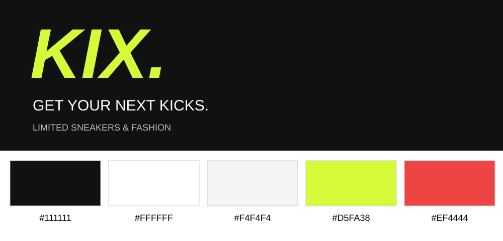

# 01. 프로젝트 기획서

> 출처: Notion "01. 프로젝트 기획서" (기획안 v1.1 스냅샷, 2026-11-26 가져옴).
> 이 문서는 원본 기록이며, 변경 사항은 [decisions.md](decisions.md)와 [design-revision-v1.2.md](design-revision-v1.2.md)에 기록한다.

KIX(킥스) — 한정판 스니커즈 및 패션 커머스 플랫폼. 재고 정합성과 중복 주문 방지를 핵심 가치로 설계한다.

- 문서 상태: 기획안 v1.1 · 개발 예정
- 개발 기간: 2026-11-26 ~ 2026-11-30 · 개인 프로젝트(1인 기준)

## 1. 기획 배경 및 의도

뉴발란스와 아디다스에서 의류 및 신발 판매 업무를 경험하며 상품과 소비자가 만나는 오프라인 구매 접점을 이해할 수 있었다. 이러한 판매 경험을 바탕으로 패션 상품의 브랜드, 디자인, 사이즈, 재고 여부가 구매 결정에 영향을 미치는 커머스 도메인에 관심을 갖게 되었다.

오프라인 매장에서의 상품 탐색과 구매 경험을 온라인으로 확장하여, 소비자가 원하는 스니커즈와 패션 상품을 쉽게 찾고 구매할 수 있는 서비스를 기획하였다. 특히 한정 수량 상품은 구매 요청이 집중될 수 있어 재고 초과 판매와 중복 주문을 예방하는 안정적인 주문 처리 구조가 필요하다.

KIX(킥스)는 스니커즈를 뜻하는 Kicks에서 착안한 이름으로, KREAM과 같은 상품 중심의 미니멀한 패션 플랫폼을 참고하되 리셀·입찰·정품 검수 대신 판매자 등록 상품의 직접 주문에 집중한다.

상품 검색, 관심 상품, 구매 후기, 주문 기능을 제공하고 동시성 제어, 멱등성, 트랜잭션을 통해 안정적인 거래 흐름을 구현하는 것이 기획 의도이다. 실제 결제 대신 모의 주문으로 검증한다.

※ 재고 초과 판매 및 중복 주문은 온라인 서비스 설계를 위한 예상 문제이며, 과거 근무 중 직접 발생한 장애나 고객 조사 결과로 주장하지 않는다.

## 2. 문제 정의

| ID | 문제 | 발생 상황 | 해결 방향 |
| --- | --- | --- | --- |
| PB-01 | 재고 초과 판매 | 재고 1개에 두 구매자가 동시에 주문 | DB 잠금과 트랜잭션으로 재고 검증·차감 |
| PB-02 | 중복 주문 | 응답 지연 후 같은 주문 재전송 | Idempotency Key 기반 기존 주문 반환 |
| PB-03 | 데이터 불일치 | 재고 차감 후 주문 저장 실패 | 단일 트랜잭션 및 롤백 |
| PB-04 | 구매 정보 부족 | 상품 정보만으로 구매 판단이 어려움 | 구매자 리뷰 및 별점 제공 |
| PB-05 | 관심 상품 관리 | 관심 표시 반복 요청으로 중복 데이터 발생 | 좋아요 등록·취소 및 복합 유니크 제약 |
| PB-06 | 권한 침해 | 다른 회원의 리뷰 수정 또는 관리자 API 접근 | 인증·인가 및 소유권 검증 |

## 3. 서비스 대상 및 가치

- 구매자: 한정 수량 상품을 조회하고 구매 가능 여부를 확인하여 주문하려는 사용자
- 판매자(관리자): 상품과 재고를 간편하게 관리하려는 소규모 판매자
- 핵심 가치: 재고 범위 내 주문 보장, 동일 구매 의도의 중복 처리 방지, 구매 후기 기반 정보 제공

## 4. 사용자 시나리오

1. 관리자가 한정판 스니커즈 10개를 등록한다.
2. 구매자는 상품 목록에서 상품을 검색하고 상세 정보와 리뷰를 확인한다.
3. 관심 상품에 좋아요를 등록하거나 즉시 주문한다.
4. 서버는 인증, 요청 키, 상품 판매 상태 및 재고를 검증한다.
5. 재고 차감과 주문 저장을 원자적으로 처리한다.
6. 구매자는 주문 결과와 본인 주문 내역을 확인한다.
7. 구매 완료 상품에 리뷰를 작성한다.

## 5. 범위 및 향후 확장

실제 PG 결제, 배송, 상품 옵션, 파일 업로드, Redis, 소셜 로그인은 MVP에서 제외한다. 장바구니, 주문 취소, 리뷰 댓글, N+1 최적화, CI/CD는 일정 여유 시 추가한다.

> 변경: 상품 옵션(신발 사이즈)은 MVP에 포함하는 것으로 변경됨. [decisions.md](decisions.md) DEC-003 참고.

## 6. 브랜드 및 추가 설계 검토

- 서비스명: KIX(킥스)
- 슬로건 제안: GET YOUR NEXT KICKS.
- 디자인 방향: 블랙·화이트 중심의 미니멀 스트릿, 라임 포인트 컬러 제안.
- 브랜드 필터 및 사이즈별 재고 관리는 도메인 특화 기능으로 검토한다. 기존 단일 상품 재고 MVP에서 변경할 경우 기능 명세·ERD·API·테스트를 함께 수정해야 한다.
- 상표 및 도메인 중복 여부는 미확인 상태이다.

## 7. 브랜드 로고 및 브랜딩 컬러

브랜드 및 추천 컬러 시안
