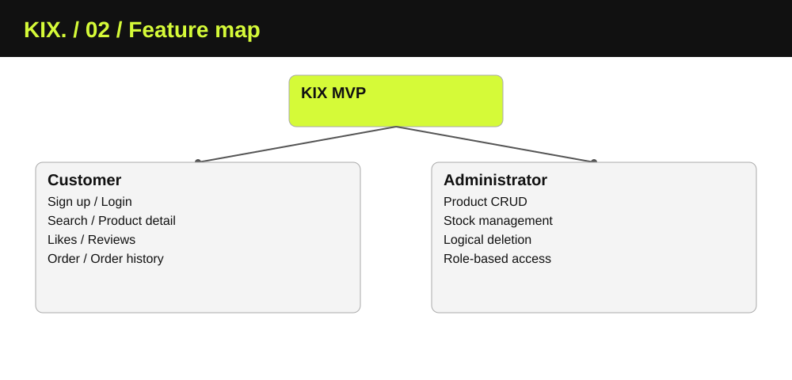

# 02. 기능 명세서

> 출처: Notion "02. 기능 명세서" (v1.1 스냅샷, 2026-11-26 가져옴).
> 사이즈 옵션·브랜드 필터 반영 등 변경 사항은 [design-revision-v1.2.md](design-revision-v1.2.md)에 정리했다.
> 용어 변경(DEC-019): 회원 도메인은 `member`로 통일했다. 이 스냅샷의 "회원" 관련 `users`·`/api/users` 표기는 `members`·`/api/members`로 읽는다.

## 1. 필수 요구사항

| ID | 기능 | 정책 |
| --- | --- | --- |
| MEM-01 | 회원가입·로그인 | 이메일 유니크, BCrypt, JWT |
| PRD-01 | 상품 CRUD | 관리자만 변경, 논리 삭제 |
| PRD-02 | 목록·검색 | 페이징, 상품명 검색 |
| REV-01 | 리뷰 CRUD | 구매 회원, 본인만 수정·삭제, 상품당 1개 |
| LIK-01 | 좋아요 | PUT/DELETE, 회원·상품 유니크 |
| ORD-01 | 주문 | 단일 상품, 수량 1 이상, 서버 가격 계산 |
| ORD-02 | 주문 조회 | 본인 주문만 조회 |
| ORD-03 | 재고 차감 | 비관적 락, 재고 부족 409 |
| ORD-04 | 멱등성 | 동일 키·내용 기존 주문 반환, 다른 내용 409 |
| ORD-05 | 원자성 | 실패 시 재고 및 주문 롤백 |

## 2. 선택 기능

리뷰 댓글, 장바구니, 주문 취소, N+1 최적화, CI/CD.

## 3. 비기능

인증·인가, 입력 검증, 공통 예외, Swagger, MySQL 통합 테스트, Docker Compose 및 AWS 배포.

## 4. MVP 요구사항

P0: 필수 / P1: 일정 여유 시 구현

| ID | 기능 | 상세 요구사항 | 우선순위 |
| --- | --- | --- | --- |
| MEM-01 | 회원가입 | 이메일 중복 방지, 비밀번호 해시 저장 | P0 |
| MEM-02 | 로그인·로그아웃 | JWT 발급, 클라이언트 토큰 제거 | P0 |
| MEM-03 | 회원 조회 | 본인 정보 조회 | P0 |
| PRD-01 | 상품 CRUD | 관리자 등록·수정·논리 삭제, 공개 조회 | P0 |
| PRD-02 | 검색·페이징 | 상품명 검색 및 페이지 조회 | P0 |
| PRD-03 | 품절 표시 | 재고 0개 또는 판매 중지 시 주문 제한 | P0 |
| REV-01 | 리뷰 CRUD | 구매 회원 작성, 본인만 수정·삭제, 상품당 1개 | P0 |
| REV-02 | 리뷰 댓글 | 리뷰에 대한 댓글 CRUD | P1 |
| LIK-01 | 좋아요 | 등록·취소·개수·본인 등록 여부 조회 | P0 |
| LIK-02 | 중복 방지 | 회원·상품 복합 유니크, 반복 요청 시 상태 유지 | P0 |
| ORD-01 | 주문 생성 | 단일 상품·수량, 서버 가격 계산 | P0 |
| ORD-02 | 주문 조회 | 본인 주문 목록 및 상세 조회 | P0 |
| ORD-03 | 재고 관리 | 비관적 락으로 초과 판매 방지 | P0 |
| ORD-04 | 주문 멱등성 | 동일 회원·키·요청 내용의 중복 주문 방지 | P0 |
| ORD-05 | 원자성 | 주문 저장 실패 시 재고 롤백 | P0 |
| ORD-06 | 주문 취소 | 중복 취소 방지 및 재고 복구 | P1 |
| CRT-01 | 장바구니 | 담기·조회·수량 수정·삭제 | P1 |

## 5. 비즈니스 정책

- 가격은 양의 정수(원), 재고는 0 이상, 주문 수량은 1 이상으로 제한.
- 주문 당시 상품 가격을 주문에 저장하고 이후 가격 변경과 분리.
- 동일 멱등성 키에 다른 상품 또는 수량이 전달되면 409 응답.
- 재고 부족 시 409 응답. 주문 생성과 재고 차감은 동일 트랜잭션에서 처리.
- 동시 중복 요청은 DB 유니크 제약과 트랜잭션 경계로 처리하고, 충돌 시 롤백 이후 별도 트랜잭션에서 기존 주문을 조회하여 요청 내용 비교.
- 상품 삭제는 논리 삭제로 처리하여 기존 주문 이력 보존.
- 리뷰는 성공한 모의 주문 이력이 있는 회원만 작성 가능.
- 좋아요는 PUT/DELETE로 상태를 지정하며 동시 등록 충돌도 안전하게 처리.
- 관리자 재고 변경 역시 주문과 동일한 재고 정합성 규칙 적용.

## 6. 전체 기능 구성도

설계 초안 · 실제 구현 또는 측정 결과가 아님
