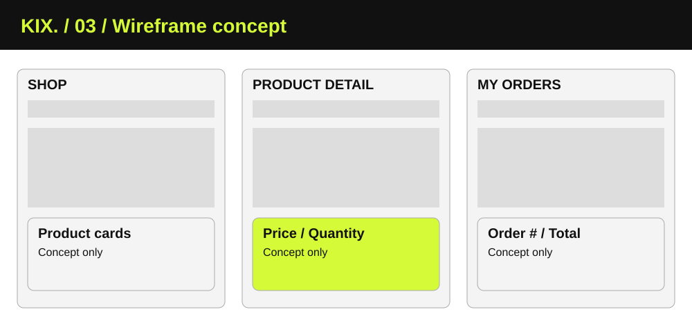

# 03. 화면 설계 (와이어프레임)

> 출처: Notion "03. 화면 설계 (와이어프레임)" (v1.1 스냅샷, 2026-11-26 가져옴).
> Notion의 와이어프레임 이미지는 박스 3개와 "Concept only" 문구뿐인 개념도이며, UI 구현 기준이 아니다. 고해상도 시안은 승인 후 `design/approved.md`에 등록한다.

## 1. 화면 구성 초안

| 화면 | 구성 |
| --- | --- |
| 상품 목록 | 검색, 상품 카드, 가격, 재고, 페이징 |
| 상품 상세 | 이미지, 가격, 수량, 좋아요, 리뷰, 구매 버튼 |
| 로그인·회원가입 | 이메일, 비밀번호, 닉네임 |
| 주문 완료 | 주문번호, 수량, 금액 |
| 마이페이지 | 주문 내역 |
| 관리자 | 상품 목록 및 등록·수정 폼 |

## 2. 상세 화면 배치

상단 내비게이션 → 상품 이미지 및 구매 정보 → 리뷰 목록 및 작성 폼.

아래 와이어프레임은 설계 초안이며 실제 구현 화면은 추후 첨부.

## 3. 주요 화면 와이어프레임

설계 초안 · 실제 구현 또는 측정 결과가 아님

## 4. 변경 사항 메모

- 상품 목록에 브랜드 필터가 추가된다.
- 상품 상세에 사이즈 선택(옵션별 재고·품절 표시)이 추가된다.
- 관리자 화면에 옵션(사이즈) 재고 관리가 추가된다.
