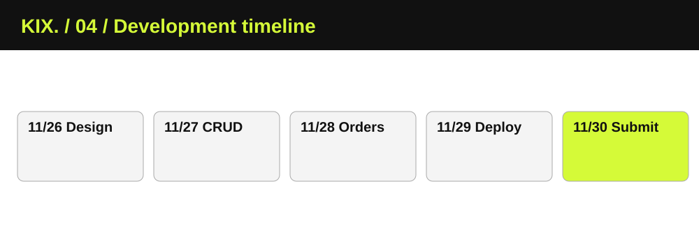

# 04. 역할 분담 & 일정

> 출처: Notion "04. 역할 분담 & 일정" (v1.1 스냅샷, 2026-11-26 가져옴).
> 실행 순서는 [progress.md](progress.md)와 [decisions.md](decisions.md)의 DEC-005 기준으로 조정한다.

## 1. 개요

1인 개발 기준 계획.

| 날짜 | 작업 |
| --- | --- |
| 11/26 | 기획, ERD, API 설계 |
| 11/27 | 회원, 상품, 리뷰, 좋아요 |
| 11/28 | 주문, 동시성, 멱등성, React 연동 |
| 11/29 | 테스트, Docker, AWS 배포 |
| 11/30 | 접속 점검 및 URL 제출 |

## 2. 개발 일정 타임라인

설계 초안 · 실제 구현 또는 측정 결과가 아님
