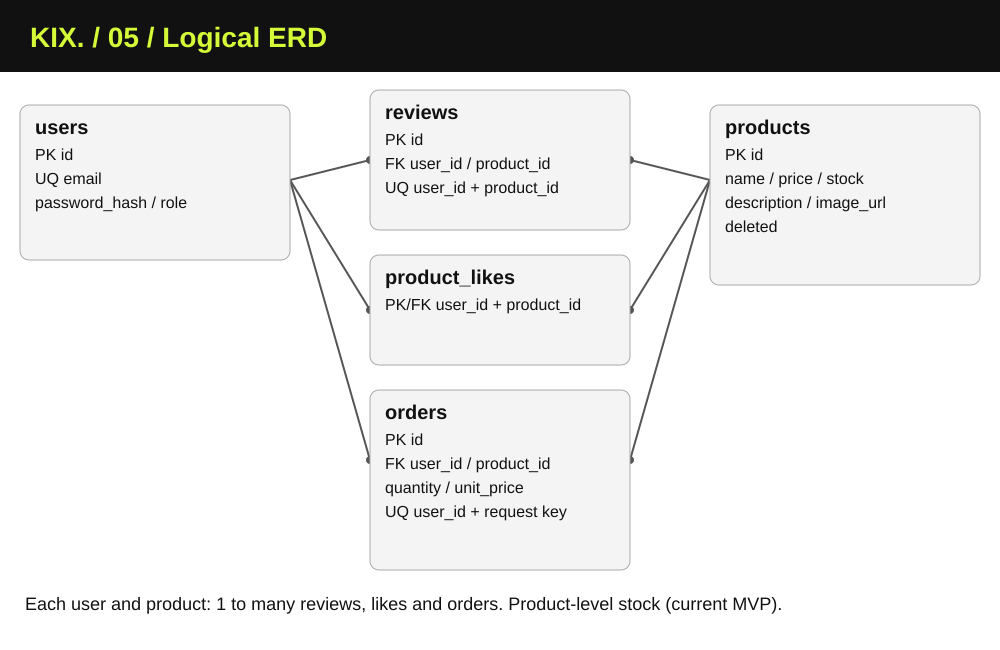

# 05. DB 설계 (ERD)

> 출처: Notion "05. DB 설계 (ERD)" (v1.1 스냅샷, 2026-11-26 가져옴).
> 용어 변경(DEC-019): 회원 테이블은 `users`가 아니라 `members`이고, FK 컬럼은 `user_id`가 아니라 `member_id`다. 아래 표와 이미지의 `users`·`user_id`는 이 이름으로 읽는다. CHECK 제약 이름은 `chk_` 접두사를 쓴다.
> 이 ERD는 상품 단위 재고 기준의 초안이다. 옵션(사이즈)별 재고를 반영한 수정안은 [design-revision-v1.2.md](design-revision-v1.2.md) 3장에 있으며 사용자 검토 후 이 문서에 반영한다.

## 1. 논리 모델 초안

| 테이블 | 주요 컬럼 및 제약 |
| --- | --- |
| users | id PK, email UNIQUE, password_hash, nickname, role |
| products | id PK, name, price, stock, description, image_url, deleted |
| reviews | id PK, user_id FK, product_id FK, rating, content, UNIQUE(user_id, product_id) |
| product_likes | user_id FK, product_id FK, 복합 PK |
| orders | id PK, user_id FK, product_id FK, quantity, unit_price, idempotency_key, UNIQUE(user_id, idempotency_key) |

회원 및 상품과 주문·리뷰·좋아요는 각각 1:N 관계. 단일 상품 주문으로 제한. 재고 음수 방지 및 FK 적용.

물리 ERD 및 DDL은 개발 전 확정 예정.

## 2. ERD 및 테이블 관계도

설계 초안 · 실제 구현 또는 측정 결과가 아님
