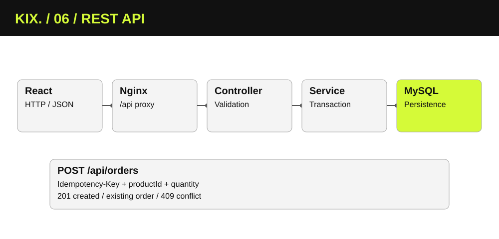

# 06. API 명세서

> 출처: Notion "06. API 명세서" (v1.1 스냅샷, 2026-11-26 가져옴).
> 누락 API 보완과 옵션 기반 주문 요청 형식은 [design-revision-v1.2.md](design-revision-v1.2.md) 4장에 있다.
> 용어 변경(DEC-019): 내 정보 조회 API는 `GET /api/members/me`다. 회원 도메인 이름은 `member`로 통일했다.

## 1. REST API 초안

| Method | Path | 기능 |
| --- | --- | --- |
| POST | /api/auth/signup | 회원가입 |
| POST | /api/auth/login | 로그인 |
| GET | /api/products | 목록·검색 |
| GET | /api/products/{id} | 상세 |
| POST | /api/products | 관리자 등록 |
| PATCH | /api/products/{id} | 관리자 수정 |
| DELETE | /api/products/{id} | 논리 삭제 |
| GET/POST | /api/products/{id}/reviews | 리뷰 조회·작성 |
| PATCH/DELETE | /api/reviews/{id} | 리뷰 수정·삭제 |
| PUT/DELETE | /api/products/{id}/likes | 좋아요 등록·취소 |
| POST | /api/orders | 주문 생성 |
| GET | /api/orders | 내 주문 조회 |
| GET | /api/orders/{id} | 주문 상세 |

주문 요청: Idempotency-Key 헤더, JSON productId 및 quantity. 최초 성공 201, 재전송 기존 주문 반환, 재고 부족 또는 키 충돌 409. 상세 DTO 및 Swagger는 구현 시 확정.

## 2. REST API 요청 및 처리 구조

설계 초안 · 실제 구현 또는 측정 결과가 아님
