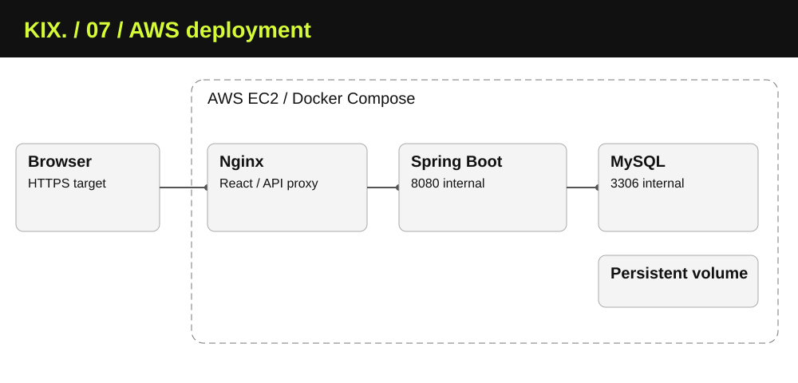

# 07. 기술 스택 & 아키텍처

> 출처: Notion "07. 기술 스택 & 아키텍처" (v1.1 스냅샷, 2026-11-26 가져옴).
> 버전은 확정되지 않았다. 선정 과정은 [decisions.md](decisions.md)와 [references.md](references.md)에 기록한다.
> **현행 기준은 [tech-stack.md](tech-stack.md)이다.** (2026-11-27 배포 아키텍처 확정으로 Nginx 컨테이너화, Tailwind CSS, GitHub Actions가 반영됨. 이 문서는 원본 스냅샷으로 유지한다.)

## 1. 개요

React + Vite / Java + Spring Boot + JPA + Security / MySQL / Docker Compose / AWS EC2 + Nginx.

브라우저 → Nginx(React 정적 파일 및 /api 프록시) → Spring Boot:8080 → MySQL:3306.

8080·3306 외부 미공개, SSH 허용 IP 제한, 환경변수로 비밀값 관리, DB 영속 볼륨 적용. HTTPS 적용 목표. 실제 개인정보 및 결제는 사용하지 않는다.

## 2. 기술 설계 방향

| 해결 대상 | 기술 | 선정 이유 |
| --- | --- | --- |
| 인증·인가 | Spring Security, JWT, BCrypt | 사용자 식별 및 접근 제한 |
| CRUD·연관관계 | Spring Data JPA, MySQL | 관계형 데이터 관리 |
| 동시성 | PESSIMISTIC_WRITE | 동일 상품 재고 변경 직렬화 |
| 멱등성 | Idempotency Key, Unique Constraint | 재전송에 따른 중복 주문 방지 |
| 원자성 | @Transactional | 주문과 재고 변경의 일관성 |
| 오류 처리 | Bean Validation, RestControllerAdvice | 일관된 오류 응답 |
| 조회 | Pageable, DTO | 목록 조회 및 응답 데이터 분리 |
| 배포 | React, Nginx, Docker Compose, AWS EC2 | 실행 환경 표준화 및 외부 접근 |

단일 상품 주문 기준으로 users, products, reviews, product_likes, orders의 5개 핵심 테이블을 우선 설계한다. 주문에 상품 ID, 수량, 주문 당시 가격, 요청 키를 저장한다. 장바구니 및 다상품 주문 구조는 확장 범위로 분리한다.

> 변경: 재고 락 단위가 상품에서 상품 옵션(사이즈)으로 바뀌고 테이블이 늘어난다. design-revision-v1.2.md 참고.

## 3. 배포 및 일정

배포 구조: 브라우저 → Nginx(React 정적 파일 및 /api 프록시) → Spring Boot → MySQL. EC2 단일 인스턴스와 Docker Compose를 사용하고 8080·3306은 외부에 공개하지 않는다. SSH는 허용 IP 제한, 비밀값은 환경변수 관리, MySQL은 영속 볼륨 적용. 공개 로그인 서비스는 HTTPS 적용을 목표로 하며 미적용 시 실제 개인정보 사용 금지 및 데모 범위 제한.

- 11/26: 기획, ERD, API 설계
- 11/27: 회원, 상품, 리뷰, 좋아요
- 11/28: 주문, 동시성, 멱등성, React 연동
- 11/29: 테스트, Docker, AWS 배포
- 11/30: 외부 접속 점검 및 URL 제출

## 4. AWS 배포 아키텍처

설계 초안 · 실제 구현 또는 측정 결과가 아님
