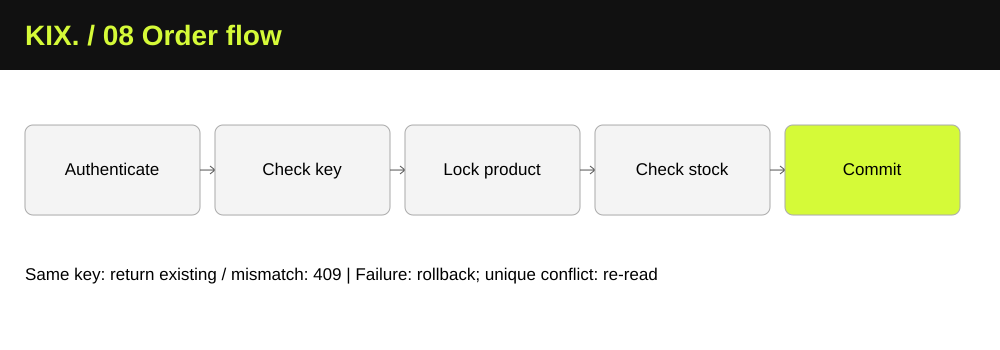

# 08. 플로우차트

> 출처: Notion "08. 플로우차트" (v1.1 스냅샷, 2026-11-26 가져옴).
> 옵션 단위 락을 반영한 주문 흐름은 [design-revision-v1.2.md](design-revision-v1.2.md) 5장에 있다.

## 1. 주문 흐름 초안

인증 → 입력 검증 → 기존 키 확인 → 동일 내용이면 기존 주문 반환 / 다른 내용이면 409 → 신규 요청이면 상품 행 잠금 → 재고 확인 → 재고 차감 및 주문 저장 → 커밋.

동시 키 충돌 시 실패 트랜잭션 롤백 후 별도 트랜잭션에서 기존 주문 조회 및 내용 비교. 재고 부족 시 409.

## 2. 좋아요 흐름

인증 → 상품 확인 → PUT 등록 또는 DELETE 취소 → 중복 요청에도 동일 상태 유지.

아래 흐름도는 설계 초안이다.

## 3. 주문 처리 플로우차트

설계 초안 · 실제 구현 또는 측정 결과가 아님
