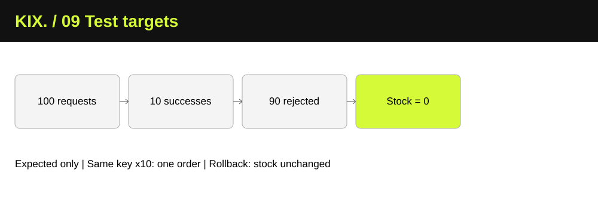

# 09. 테스트 & 트러블슈팅

> 출처: Notion "09. 테스트 & 트러블슈팅" (v1.1 스냅샷, 2026-11-26 가져옴).
> 아래 수치는 모두 **목표**이며 실제 측정 결과가 아니다. 보강된 테스트 계획은 [design-revision-v1.2.md](design-revision-v1.2.md) 6장에 있다.
> 실제 실행 결과와 트러블슈팅은 이 문서 4장 이후에 추가한다.

## 1. 개요

| 테스트 | 목표 |
| --- | --- |
| 재고 10개, 1개씩 100건 동시 주문 | 10건 성공, 90건 재고 부족 |
| 동일 키 10건 동시 요청 | 주문 1건, 재고 차감 1회 |
| 동일 키 다른 수량 | 409 |
| 주문 저장 실패 | 재고 롤백 |
| 좋아요 반복 등록 | 1건 유지 |
| 비회원 주문·일반 회원 관리자 API | 401·403 |

실제 MySQL 통합 테스트 예정. 결과는 미측정.

## 2. 기록 양식

문제 / 재현 조건 / 원인 / 해결 / 적용 전후 결과 / 관련 커밋.

## 3. 검증 기준

| 테스트 | 조건 | 기대 결과 |
| --- | --- | --- |
| 동시 주문 | 재고 10개, 1개씩 서로 다른 주문 100건 | 성공 10건, 재고 부족 90건, 최종 재고 0 |
| 중복 주문 | 동일 회원·키·내용 10회 동시 요청 | 주문 1건, 재고 차감 1회 |
| 키 충돌 | 동일 키, 다른 수량 | 409 |
| 롤백 | 재고 차감 후 주문 저장 실패 | 기존 재고 유지 |
| 좋아요 | 동일 등록 요청 반복·동시 실행 | 좋아요 1건 |
| 접근 제어 | 비회원 주문 / 일반 회원 상품 등록 | 401 / 403 |
| 영속성 | DB 컨테이너 재생성 | 볼륨 데이터 유지 |
| 배포 | 외부 브라우저 접속 | 정상 서비스 이용 |

위 수치는 테스트 목표이며 실제 측정 결과는 개발 후 별도 기록한다. 동시성 테스트는 실제 MySQL 환경에서 수행한다.

## 4. 동시성 및 멱등성 테스트 시나리오

설계 초안 · 실제 구현 또는 측정 결과가 아님

## 5. 실행 결과 기록

아직 실행한 테스트가 없다.
