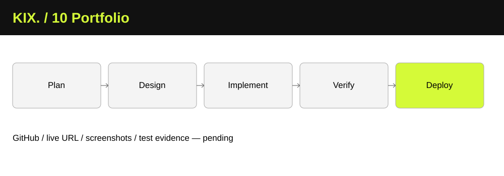

# 10. 최종 발표 자료 & 회고

> 출처: Notion "10. 최종 발표 자료 & 회고" (v1.1 스냅샷, 2026-11-26 가져옴).
> 발표 자료와 결과는 개발 완료 후 작성한다. 실제 성과는 구현과 검증 후에만 기록한다.

## 1. 발표 구성 초안

서비스 소개 → 문제 정의 → 핵심 기능 시연 → 동시성·멱등성 해결 → 테스트 결과 → 배포 구조 → 회고.

- [ ] GitHub URL
- [ ] AWS 배포 URL
- [ ] 실제 구현 범위
- [ ] 테스트 결과 및 화면 캡처
- [ ] 개선점 및 회고

발표 자료 및 결과는 개발 완료 후 작성.

## 2. 개발 산출물 및 결과 기록

- [ ] ERD 및 API 명세서
- [ ] GitHub Repository 및 README
- [ ] 핵심 기능 구현
- [ ] 동시성·멱등성 테스트 결과
- [ ] 트러블슈팅 기록(문제 → 원인 → 해결 → 검증)
- [ ] AWS 배포 URL
- [ ] 실제 구현 범위 및 기획 변경 사항 정리

GitHub URL 및 배포 URL: 개발 완료 후 추가.

기대 효과: 재고 초과 판매와 중복 주문 위험 감소, 구매 후기 제공, 판매자의 상품 관리 간소화. 실제 성과는 구현 및 검증 후 기록한다.

## 3. 프로젝트 진행 과정 및 산출물

설계 초안 · 실제 구현 또는 측정 결과가 아님
