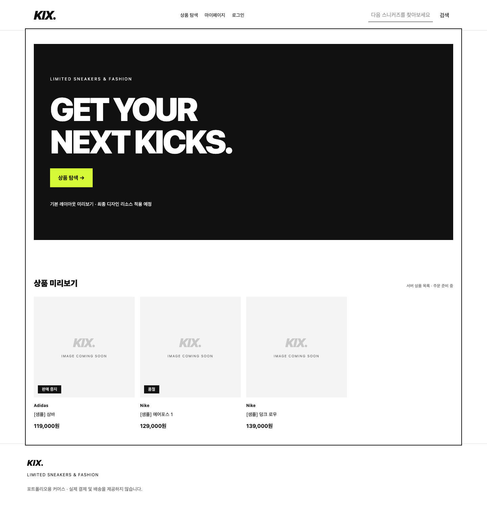
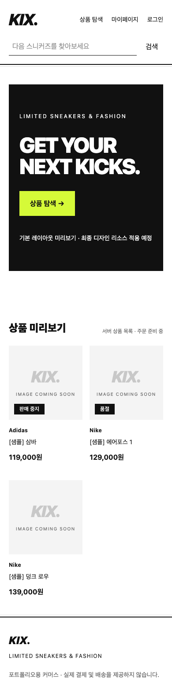
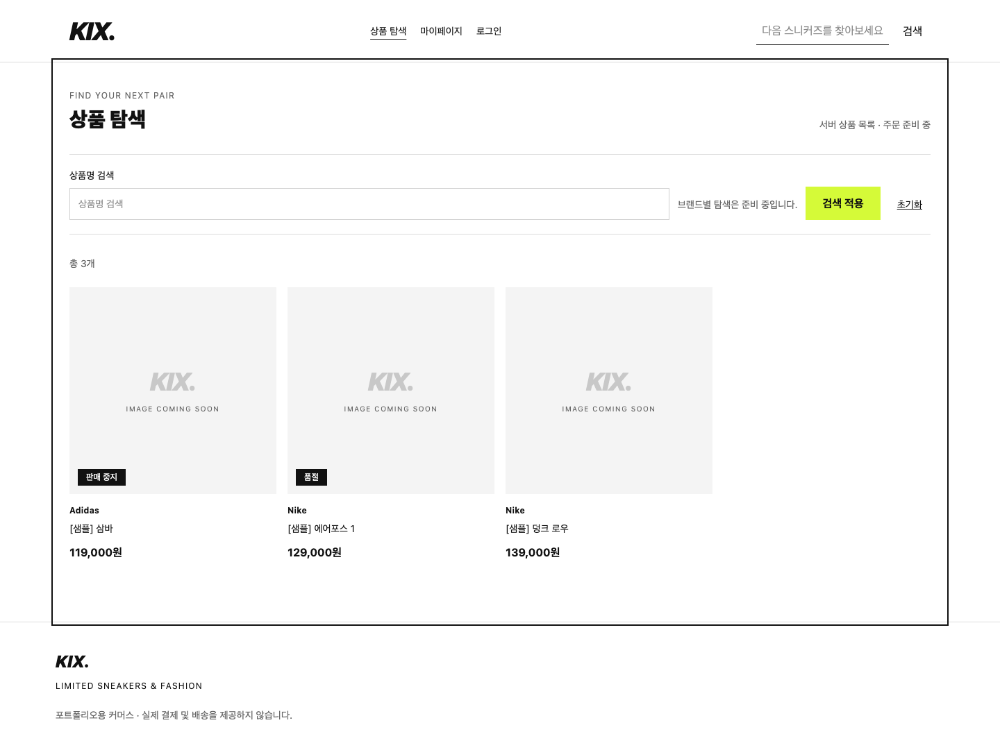
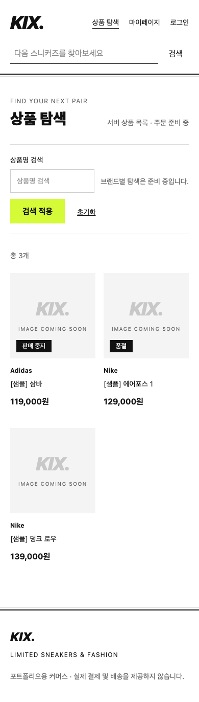
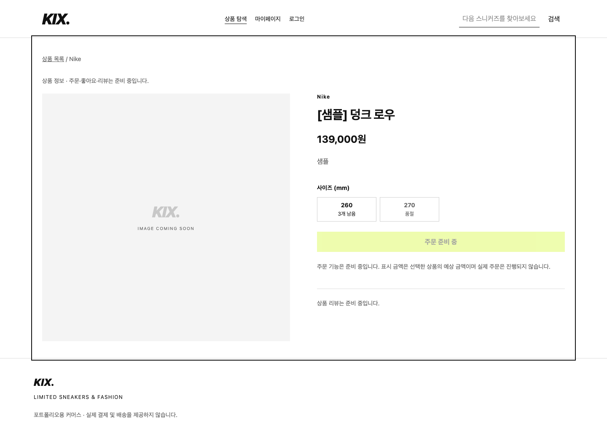
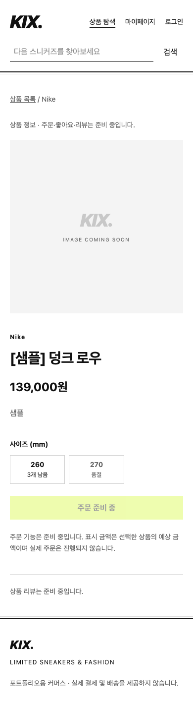
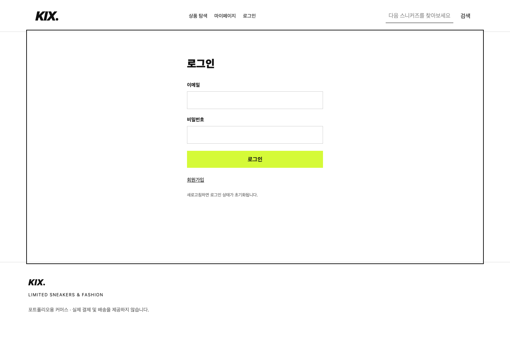
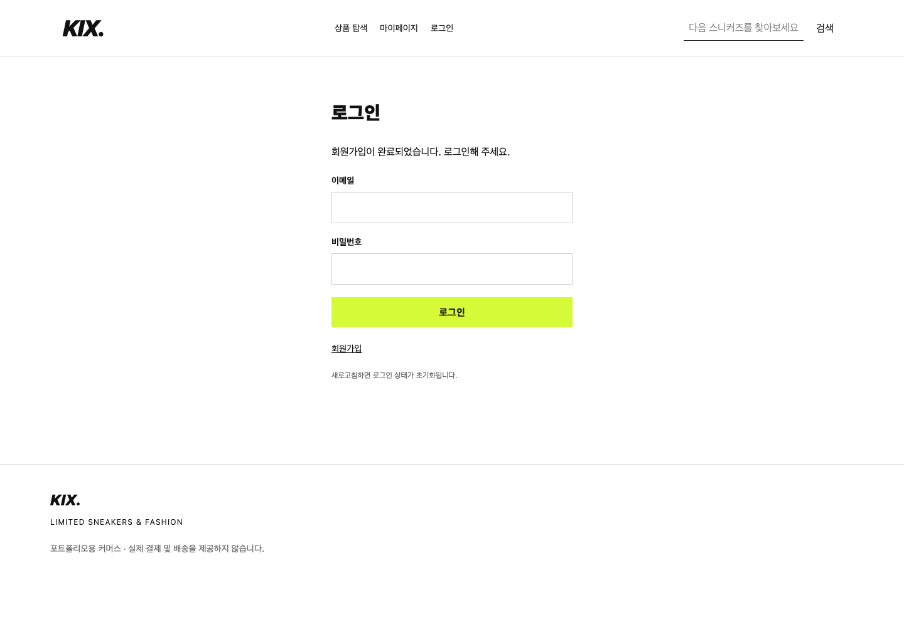
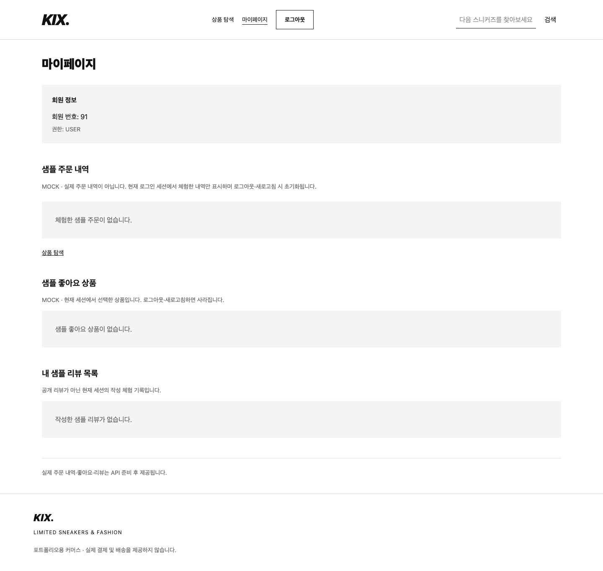
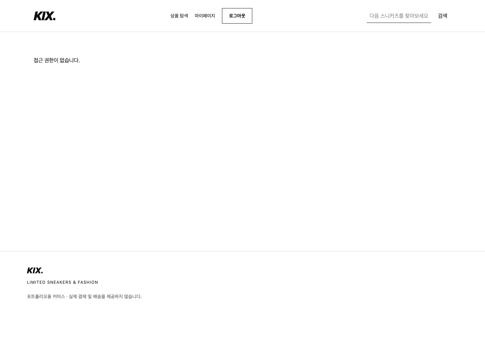

# KIX 화면·인증 연동 현황

확인일: 2026-11-28. 이 문서는 로컬 프론트엔드와 `127.0.0.1:8080` 개발 백엔드를 연결해 확인한 결과다. 캡처 시 화면은 1440×1000 CSS px, 모바일은 390×844 CSS px이며 브라우저 배율은 1이다.

## 화면 캡처

| 화면                  | 캡처                                                                   |
| --------------------- | ---------------------------------------------------------------------- |
| 홈 데스크톱           |                            |
| 홈 모바일             |                               |
| 상품 목록 데스크톱    |                 |
| 상품 목록 모바일      |                    |
| 상품 상세 데스크톱    |           |
| 상품 상세 모바일      |              |
| 로그인                |                                |
| 가입 완료 안내        |                |
| 로그인 후 마이페이지  |  |
| USER 관리자 접근 거부 |     |

## 배너·상품 이미지 규격

측정은 현재 기본 레이아웃의 실제 CSS 표시 크기다. 히어로에는 현재 이미지 슬롯이 없으며 문구가 들어간 어두운 영역 전체를 측정했다. 디자인 제작 시 아래 비율을 참고하고, 텍스트가 포함된 완성 배너인지 배경 전용 이미지인지는 시안에서 정한다.

| 영역             | 데스크톱 표시 크기·비율 | 모바일 표시 크기·비율 | 제작 참고                                                                        |
| ---------------- | ----------------------- | --------------------- | -------------------------------------------------------------------------------- |
| 홈 히어로 전체   | 1240×580 px · 2.14:1    | 350×420 px · 0.83:1   | 별도 데스크톱/모바일 구도를 권장. 2배 원본 기준 약 2480×1160, 700×840 px         |
| 상품 카드 이미지 | 298×298 px · 1:1        | 167×167 px · 1:1      | 공통 정사각형 원본 권장. 1200×1200 px 이상이면 현재 화면에 충분                  |
| 상품 상세 이미지 | 588×588 px · 1:1        | 350×350 px · 1:1      | 카드와 같은 정사각형 원본 재사용 가능. 확대·크롭에 대비해 1200×1200 px 이상 권장 |

카드 목록은 데스크톱 4열·태블릿 3열·모바일 2열이다. 이미지는 `object-contain`으로 표시해 현재 원본이 없는 경우에도 레이아웃 비율을 유지한다.

## 실제 상품 API 데이터

`GET /api/products?page=0&size=20` 응답에서 확인한 상품이다. 금액·재고는 API 응답값이고 이미지 URL은 모두 `null`이다.

| 상품 ID | 브랜드              | 상품명            |      가격 | 상태    | 판매 가능 | 옵션 재고              |
| ------- | ------------------- | ----------------- | --------: | ------- | --------- | ---------------------- |
| 16      | Adidas (brandId 15) | [샘플] 삼바       | 119,000원 | STOPPED | 불가      | 없음                   |
| 15      | Nike (brandId 14)   | [샘플] 에어포스 1 | 129,000원 | ON_SALE | 품절      | 260 mm 0개, 270 mm 0개 |
| 14      | Nike (brandId 14)   | [샘플] 덩크 로우  | 139,000원 | ON_SALE | 가능      | 260 mm 3개, 270 mm 0개 |

상세 API `GET /api/products/{id}`의 옵션 필드는 `sizeMm`이며 목록은 ID 16, 15, 14 순으로 반환됐다. 이미지가 등록된 상품은 없어 실제 상품 촬영 이미지 검증은 아직 불가하다.

## 이미지 파일 경로

- 승인된 원본 리소스 디렉터리: `design/brand/`, `design/banners/`, `design/products/` — 현재 `.gitkeep`만 있고 실제 파일은 없다.
- 프론트엔드 런타임 정적 자산 경로: `frontend/src/assets/` — 아직 실물 이미지 파일이 없다.
- 이미지 렌더링·대체 표시: `frontend/src/features/products/ProductImage.jsx`. 서버 `imageUrl` 또는 프론트 정적 경로를 받아 정사각형 영역에 표시하고, 값이 없거나 로딩에 실패하면 KIX 준비 중 UI를 보여준다.
- 현재 캡처: 이 문서의 `screenshots/` 하위. UI 참조용이며 서비스 이미지 자산은 아니다.

디자인 리소스는 승인 후 `design/` 원본을 기준으로 프론트 자산에 적용한다. 상품별 이미지 연결은 실제 API의 `imageUrl`을 사용한다.

## 토큰·CSS

`design/tokens/tokens.json`에 정의된 색상은 다음과 같다. 타이포그래피·간격·모서리 토큰은 아직 비어 있다.

| 토큰       | 값        |
| ---------- | --------- |
| Primary    | `#111111` |
| Background | `#FFFFFF` |
| Surface    | `#F4F4F4` |
| Accent     | `#D5FA38` |
| Danger     | `#EF4444` |

추가 CSS 변수는 `frontend/src/styles/index.css`의 Tailwind `@theme`에 있다: `--color-primary`, `--color-background`, `--color-surface`, `--color-accent`, `--color-secondary`(`#666666`), `--color-danger`, `--font-sans`(Pretendard 우선 시스템 폴백). 시안 전달 전 색·타이포·간격을 임의로 변경하지 않는다.

## 컴포넌트 구조와 디자인 적용 파일

- `src/layouts/RootLayout.jsx`: 공통 헤더·푸터·검색·로그인 상태
- `src/pages/HomePage.jsx`: 메인 히어로·상품 탐색 진입
- `src/pages/ProductsPage.jsx`, `src/features/products/ProductCard.jsx`: 상품 목록·카드
- `src/pages/ProductDetailPage.jsx`, `src/features/products/ProductOptions.jsx`: 상세·사이즈 및 수량
- `src/features/products/ProductImage.jsx`: 카드·상세 이미지와 대체 UI
- `src/pages/AuthPage.jsx`: 로그인·회원가입
- `src/pages/AccountPage.jsx`: 회원 정보와 현재 샘플 영역 표시
- `src/routes/RequireAuth.jsx`, `src/routes/AppRoutes.jsx`: 인증 및 ADMIN 화면 가드
- `src/components/`: Button, InputField, Modal, Pagination, Feedback 등 공통 UI
- `src/styles/index.css`: 디자인 토큰 적용 지점

로고 적용은 `RootLayout.jsx`의 워드마크, 메인 배너는 `HomePage.jsx`, 상품 이미지는 `ProductImage.jsx`와 API의 `imageUrl`이 연결 지점이다. 화면 시안의 승인이 있으면 해당 컴포넌트만 필요한 범위에서 수정한다.

## 실제 인증 계약과 검증

백엔드 Controller/DTO 확인:

- `POST /api/auth/signup`: `{ email, password, nickname }` → 201 `{ id, email, nickname }`. 가입 회원은 USER다.
- `POST /api/auth/login`: `{ email, password }` → `{ accessToken, tokenType: "Bearer", expiresIn: 3600 }` (`expiresIn` 단위 초).
- `GET /api/members/me`: `Authorization: Bearer <accessToken>` → `{ id, role }`. 현재 응답에 이메일·닉네임은 포함되지 않는다.
- 로그아웃 API와 Refresh Token은 없다. 프론트가 React 메모리의 세션을 비우며 새로고침하면 로그인 상태가 초기화된다.
- 실제 서버 확인: 가입 201, 로그인 Bearer 토큰, `/me` 200, 토큰 없음/위조 401, USER 토큰의 `/api/admin/anything` 403. 프론트 화면에서 USER의 `/admin` 접근 거부, 로그아웃 후 로그인 링크 복귀 및 보호 경로의 로그인 리다이렉트를 확인했다.
- 401이 현재 요청의 세션 토큰과 일치할 때만 메모리 세션을 제거한다. 403은 세션을 지우지 않고 권한 오류를 표시한다. Axios 단위 검사에서 두 동작을 검증했다.
- 실브라우저 인증 테스트와 자동화 재시도 과정에서 고유 테스트 회원 4건을 개발 DB에 생성했다. 최종 성공 흐름의 회원 번호는 91이다. 회원가입에는 삭제 API가 없어 네 테스트 데이터는 DB에 남아 있다.

## 검증 실행 결과

- API 모드 실제 브라우저: 상품 목록·상세, 가입·로그인·회원 정보, 로그아웃·가드, 401/403 응답, PC/모바일 캡처. 브라우저 `pageerror` 0건.
- `npm test`: 20개 통과
- `npm run lint`: 통과
- `npm run format:check`: 통과
- `VITE_PRODUCT_DATA_SOURCE=api npm run build`: 통과. React Router 모듈의 `"use client"` directive를 번들러가 보존하지 못할 수 있다는 기존 경고 1건은 남아 있다.

주문·좋아요·리뷰·관리자 데이터 API 연동은 이 검증에 포함하지 않았다. 샘플 UI 상태와 실제 서버 기능을 혼동하지 않는다.
